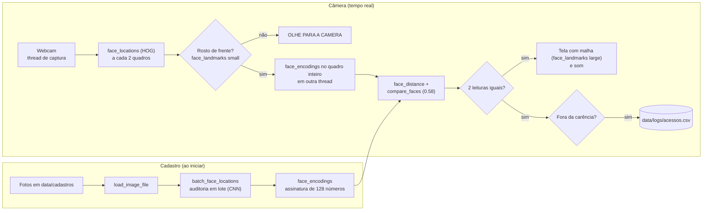

# VISIONGUARD | Sistema de Controle de Acesso Biométrico

**Instituição:** Centro Universitário UniAnchieta  
**Disciplina:** Engenharia de Software (Entrega 3)  
**Professor:** Prof. Dr. Roger Antunes  

## Equipe de Desenvolvimento
| Integrante | RA | Papel |
| :--- | :--- | :--- |
| Arthur Cortez de Azevedo | 2606317 | Produto e Comercial |
| Caua Olaia Ferrari | 2603820 | Desenvolvedor (módulo de cadastro e vídeo da demonstração) |
| César Amarez Zotovici | 2614117 | Gestor de Projeto |
| Gabriel Angioleto | 2601619 | Qualidade e Documentação |
| Leonardo Gabriel de Lima Costa | 2527941 | Líder Técnico / Arquiteto |

> Os papéis de Caua e Gabriel foram trocados em novembro em relação à Entrega 1, com o aceite do professor (ver `docs/atas/`).

## Visão Geral do Projeto
O **VisionGuard** é um protótipo MVP (Produto Mínimo Viável) de controle de acesso físico baseado em biometria facial, desenvolvido em Python. O sistema monitora um fluxo de vídeo em tempo real, detecta rostos, mapeia traços anatômicos e valida a identidade contra uma base de dados local autorizada.

O projeto destaca-se pela sua **arquitetura assíncrona multithread**, que separa a captura de vídeo da inferência matemática pesada, garantindo um monitoramento fluido, sem atraso perceptível na imagem.

---

## Para quem é

O **VisionGuard** foi desenvolvido para auxiliar recepcionistas e profissionais de segurança patrimonial no controle de acesso em ambientes como academias e condomínios.

Nesses estabelecimentos, os horários de maior movimento podem gerar filas e atrasos na identificação de pessoas autorizadas. Além disso, o uso de crachás físicos apresenta riscos de perda, empréstimo ou utilização por terceiros.

Para solucionar essas dificuldades, o VisionGuard utiliza uma webcam para comparar o rosto das pessoas com fotografias previamente cadastradas. O sistema informa se a identificação foi autorizada ou negada e registra automaticamente as ocorrências em um arquivo CSV, com data e horário.

Entre seus principais diferenciais estão o baixo custo de implementação, a utilização de equipamentos comuns e o funcionamento local, sem necessidade de conexão com a internet.

**Limitações:** nesta versão, o VisionGuard não abre portas ou catracas fisicamente e não possui mecanismos de prova de vida, podendo ser enganado por fotografias. Portanto, é indicado como ferramenta de apoio à identificação e ao registro de acessos, não como substituto completo de sistemas de segurança física.

## Arquitetura e Fluxo de Dados
O projeto utiliza um padrão modular limpo (`src/utilitarios.py` e `src/reconhecedor.py` invocados por um `main.py` central):

* **Thread de Captura:** O OpenCV lê o hardware da câmera continuamente em background para esvaziar o buffer do Windows (`ThreadedCamera`).
* **Auditoria Prévia:** Ao inicializar, o sistema localiza em lote, com o detector CNN, o rosto de cada foto de cadastro (`batch_face_locations`). A assinatura biométrica é gerada a partir do rosto encontrado; se o CNN não achar rosto numa foto, o sistema tenta o detector HOG antes de descartá-la.
* **Pipeline de Detecção:** Detecção via HOG a cada 2 quadros. Quando há várias pessoas, só o rosto mais próximo da câmera (o maior) é verificado; os demais aparecem em cinza com o aviso "AGUARDE SUA VEZ". Antes do reconhecimento, o sistema confere se o rosto está de frente: recusa o rosto que o detector HOG encontrou com um dos seus filtros de perfil, o rosto inclinado ou virado (olhos desnivelados ou nariz fora do centro) e o rosto cortado na borda do quadro. Depois de qualquer uma dessas situações, espera 1 segundo com o rosto de frente antes de verificar. A busca de rostos usa o quadro reduzido a 1/4, mas a assinatura do rosto é calculada no quadro inteiro, para mais precisão. O HUD desenha a malha biométrica de 68 pontos.
* **Histerese e Logs:** tolerância euclidiana de `0.58`. Para liberar, o sistema exige 2 leituras iguais seguidas; para negar, o "desconhecido" precisa se manter por 2 segundos, o que evita negações falsas enquanto a pessoa se mexe. Os acessos vão para `data/logs/acessos.csv`, seguindo as regras da seção "Regras do Registro".

### Como os dados andam



### Regras do Registro

O `data/logs/acessos.csv` tem uma linha por evento, com Data, Hora, Nome e Status (`AUTORIZADO` ou `NEGADO`).

| Situação | O que acontece |
| :--- | :--- |
| Pessoa parada diante da câmera | Um único registro, na chegada |
| A mesma pessoa volta em menos de 5 minutos | O som toca, mas não há linha nova no log (carência) |
| A mesma pessoa volta depois de 5 minutos | Novo registro |
| Duas pessoas se alternando na frente da câmera | Cada uma é registrada no máximo uma vez a cada 5 minutos |
| Pessoa desconhecida | Negada depois de 2 segundos diante da câmera e registrada como `DESCONHECIDO` / `NEGADO`, com carência de 30 segundos, porque todos os estranhos compartilham o mesmo nome |
| Ninguém na câmera por 2 segundos | O sistema considera que a pessoa saiu; a próxima aparição conta como nova chegada |

O sistema não distingue entrada de saída: cada chegada diante da câmera conta como um evento. Os tempos de carência ficam em `src/reconhecedor.py` (`CARENCIA_AUTORIZADO` e `CARENCIA_DESCONHECIDO`).

---

## Uso da Biblioteca `face_recognition` (Critério dos 8 Recursos)
O VisionGuard usa a biblioteca em dois módulos (`src/utilitarios.py` e `src/reconhecedor.py`), com os 8 recursos abaixo.

> **Como contamos:** a API pública da `face_recognition` tem 7 funções, e o sistema usa **todas elas**. A função `face_landmarks` aparece duas vezes na tabela porque usamos os **dois modelos treinados** que ela oferece: o de 5 pontos (`small`) e o de 68 pontos (`large`). São modelos diferentes, com finalidades diferentes no sistema (recursos 5 e 6).

| Nº | Recurso | Módulo | Uso no Sistema |
| :---: | :--- | :--- | :--- |
| **1** | `load_image_file` | `src/utilitarios.py` | Lê as fotos de cadastro como matrizes NumPy RGB. |
| **2** | `face_encodings` | `src/utilitarios.py` e `src/reconhecedor.py` | Gera a assinatura de 128 dimensões: no cadastro, com `num_jitters=5` (5 reamostragens para mais robustez) e a partir do rosto achado pela auditoria; na câmera, para o rosto que está sendo verificado. |
| **3** | `batch_face_locations` | `src/utilitarios.py` | Localiza em lote, com o detector CNN, o rosto de cada foto de cadastro. Avisa sobre fotos sem rosto ou com mais de um rosto. |
| **4** | `face_locations(model="hog")` | `src/reconhecedor.py` | Detecta os rostos da câmera em tempo real. |
| **5** | `face_landmarks(model="small")` | `src/reconhecedor.py` | Modelo de 5 pontos: confere se os olhos estão nivelados e o nariz centralizado, e recusa rostos inclinados ou de perfil antes do reconhecimento. |
| **6** | `face_landmarks(model="large")` | `src/reconhecedor.py` | Modelo de 68 pontos: desenha a malha biométrica no HUD. |
| **7** | `face_distance` | `src/reconhecedor.py` | Calcula a distância entre o rosto da câmera e cada rosto cadastrado; a menor distância indica o candidato e gera o percentual exibido. |
| **8** | `compare_faces(tolerance=0.58)` | `src/reconhecedor.py` | Decide se o candidato está dentro da tolerância de 0.58 para ser autorizado. |

---

## Guia de Instalação e Execução

### Pré-requisitos
* Windows 10 ou 11 (o sistema usa o DirectShow para a webcam e o `winsound` para os alertas sonoros).
* Python 3.12. Confira com `py -3.12 --version`, que deve mostrar `Python 3.12.x`. Com outra versão, o programa pode fechar sem nenhuma mensagem (problema P1 em `docs/testes.md`).
* Processador com suporte a AVX. O `dlib-bin` vem compilado com essas instruções; sem elas (por exemplo, no Intel Celeron N4000), o programa fecha sem mensagem ao carregar o `dlib` (P3).
* Webcam. O sistema abre a câmera pelo DirectShow e, se ele falhar, tenta o Media Foundation em 1280x720, o caminho usado por câmeras como o celular pelo DroidCam (P5). Até agora, esse segundo caminho só foi testado com um adaptador; o reteste está pendente.

Não é preciso instalar compilador C++ nem CMake: o projeto usa o `dlib-bin`, que já vem compilado.

### Passo a Passo

1. **Clonar o repositório:**
   ```powershell
   git clone https://github.com/leocosta-dev26/sistema-seguranca-facial
   cd sistema-seguranca-facial
   ```

2. **Criar e ativar o ambiente virtual com o Python 3.12:**
   ```powershell
   py -3.12 -m venv venv
   .\venv\Scripts\Activate.ps1
   ```
   Se o PowerShell bloquear a ativação, rode antes `Set-ExecutionPolicy -Scope CurrentUser RemoteSigned`.
   No Prompt de Comando (cmd), a ativação é `venv\Scripts\activate` (P2).

3. **Instalar as dependências:**
   ```powershell
   pip install --no-deps -r requirements.txt
   ```
   O `--no-deps` é obrigatório. Sem ele, o pip tenta compilar o `dlib` original, o que falha sem o Visual C++ instalado.

4. **Preparar a base e executar:**
   * Coloque uma foto nítida e de frente (ex.: `Leonardo.jpg`) na pasta `data/cadastros/`. São aceitos `.jpg`, `.jpeg` e `.png`.
   * Inicie a aplicação:
     ```powershell
     python main.py
     ```
   * Para encerrar, pressione `q` ou feche a janela.
   * Para medir a tolerância de reconhecimento, inicie com `python main.py --calibrar`: a distância de cada leitura aparece no terminal (0 = rosto idêntico; quanto maior, mais diferente; abaixo de `0.58`, o acesso é liberado).

## Como usar

Com o sistema aberto (`python main.py`), a janela **"VisionGuard - Controle de Acesso Facial"** mostra a câmera. No alto ficam o número de pessoas cadastradas (`BASE`) e o horário. Fique de frente para a câmera, a menos de 1 metro.

### O que aparece na tela

| Situação | Tela | Som |
| :--- | :--- | :--- |
| Pessoa cadastrada | Moldura **verde**, malha de pontos no rosto e o cartão "ACESSO LIBERADO" com o nome e o percentual | Dois bipes agudos |
| Pessoa desconhecida | Moldura **vermelha** e o cartão "ACESSO NEGADO" / "DESCONHECIDO" | Um bipe grave e longo |
| Rosto de lado ou inclinado | Moldura **cinza** com "OLHE PARA A CAMERA" (o rosto não é verificado) | Nenhum |
| Outras pessoas no quadro | Moldura **cinza** com "AGUARDE SUA VEZ": só o rosto mais próximo da câmera é verificado | Nenhum |
| Rosto encostado na borda da imagem | Moldura **cinza** com "CENTRALIZE O ROSTO" (o rosto não é verificado) | Nenhum |
| Sistema ainda decidindo | Moldura **cinza** com "VERIFICANDO..." | Nenhum |

O sistema só decide depois que o rosto fica 1 segundo de frente e estável. Para liberar, exige duas leituras iguais seguidas; para negar, o "desconhecido" precisa se manter por 2 segundos. Por isso aparece "VERIFICANDO..." por um instante antes do resultado.

### O registro (log)

Cada chegada diante da câmera gera uma linha em `data/logs/acessos.csv`, com Data, Hora, Nome e Status (`AUTORIZADO` ou `NEGADO`). Para não encher o log, a mesma pessoa só é registrada de novo depois de 5 minutos, e um desconhecido depois de 30 segundos (ver "Regras do Registro"). Enquanto isso, o som toca e o terminal mostra `[CARÊNCIA]`, mas nenhuma linha nova entra no log.

### O que aparece no terminal

* `[EVENTO] AUTORIZADO: Nome (88.2%, distância 0.283)` ou `[EVENTO] NEGADO: DESCONHECIDO (...)`: um registro novo no log.
* `[CARÊNCIA] Nome já registrado há 47 s; sem novo registro no log.`: a pessoa voltou antes do fim da carência.
* `[CÂMERA] Webcam aberta pelo DirectShow.`: por qual caminho a câmera foi aberta.
* Só com `--calibrar`: `[CALIBRAÇÃO]` mostra a distância de cada leitura, e `[ROSTO]` mostra as medidas da checagem de rosto de frente (filtro do detector, inclinação e posição do nariz).

### Encerrar

Pressione `q` com a janela da câmera selecionada, ou feche a janela pelo X.

## Riscos e Plano B

| Risco | Plano B |
| :--- | :--- |
| O sistema só roda no Windows (`cv2.CAP_DSHOW` e `winsound`) | Apresentar no notebook do Leonardo, já instalado e testado |
| A webcam ou a demonstração ao vivo falhar | Vídeo da demonstração gravado com antecedência, com cópia offline |
| A instalação falhar numa máquina nova | Ambiente instalado e testado antes da apresentação; instalação com `pip install --no-deps -r requirements.txt` |
| A máquina da apresentação não ter processador com AVX ou ter uma webcam que o sistema não consiga abrir | Apresentar no notebook do Leonardo, onde o sistema já foi testado |
| Pouca luz na sala | Posicionar a câmera de frente para a luz; resultado do teste de iluminação registrado nos casos de teste |

## Casos de Teste e Resolução de Falhas Críticas

Durante a fase de testes práticos da Entrega 3, documentamos os seguintes cenários:

1. **Teste de Sucesso (Condições Normais):** Identificação estabilizada entre 85% e 89% de confiança com o rosto real de frente (medido nos testes T02, T07, T10, T12 e T13), com dois bipes agudos e registro de status "AUTORIZADO" no CSV. Negação ("DESCONHECIDO", com bipe grave) ao captar uma face não cadastrada (T03); depois das correções de 08/11, a negação só acontece quando o desconhecido se mantém por 2 segundos.
2. **Registro de Falha e Contingência (Latência de Vídeo):**
* **O Problema:** Na primeira iteração, a execução síncrona da inferência pesada (`face_encodings`) a cada quadro bloqueava a CPU, acumulando quadros na fila do driver e gerando um atraso de 1,5 a 2 segundos na imagem da câmera.
* **A Solução Aplicada:** Refatoramos a arquitetura para **Multithreading Assíncrono**. A câmera passou a ser consumida em tempo real por uma thread paralela dedicada (`ThreadedCamera`), enquanto a inferência pesada roda em segundo plano disparada apenas com enquadramento frontal validado. O atraso foi eliminado, e a imagem passou a acompanhar a câmera sem atraso perceptível.


3. **Limitações do Modelo:** nos testes, o sistema reconheceu o rosto até cerca de 1 metro da câmera; mais longe, o rosto nem é detectado, por causa da redução de escala em 0.25x adotada para otimizar o processador (T09). As demais limitações estão na seção "Limitações conhecidas".

A tabela completa dos 16 casos de teste, com as evidências de cada um, está em [`docs/testes.md`](docs/testes.md).

---

## Limitações conhecidas

Cada item foi confirmado nos testes. Os detalhes e as evidências estão em [`docs/testes.md`](docs/testes.md).

* **Exige processador com suporte a AVX.** O `dlib-bin` vem compilado com instruções AVX. Num processador sem AVX (por exemplo, o Intel Celeron N4000), o programa fecha sem nenhuma mensagem ao carregar o `dlib` (T01).
* **Só funciona no Windows** (usa o DirectShow, o Media Foundation e o `winsound`). A abertura pelo Media Foundation, para câmeras como o DroidCam, ainda precisa ser retestada sem o adaptador (P5).
* **Não há prova de vida:** uma foto da pessoa cadastrada mostrada à câmera libera o acesso, com confiança até maior que a do rosto real (93% contra 85% a 89%) (T06).
* **Alcance de cerca de 1 metro.** Mais longe, o rosto não é detectado (T09). O desempenho com pouca luz ainda não foi medido (T08).
* **Verifica uma pessoa por vez:** só o rosto mais próximo da câmera; os outros ficam em cinza com "AGUARDE SUA VEZ" (T04).
* **Rosto de lado:** nos testes, um rosto quase de perfil passou pela checagem de frente e foi confundido com outra pessoa cadastrada (P6). A checagem passou a usar o filtro de perfil do detector, e no reteste com uma pessoa cadastrada os dois lados foram barrados. Falta repetir com duas pessoas cadastradas.
* **Leituras falsas de "DESCONHECIDO":** ao entrar, sair ou virar o rosto, a pessoa cadastrada chegou a ser negada (P7). Com a assinatura no quadro inteiro, a espera de 1 s e a negação só depois de 2 s, os casos caíram de vários por teste para raros, mas ainda podem acontecer. Uma foto de cadastro tirada pela própria webcam deve ajudar.
* **Todos os desconhecidos têm o mesmo nome** ("DESCONHECIDO"). Por isso, um segundo estranho que chega menos de 30 segundos depois do primeiro não é registrado (T14).
* **O percentual exibido não é uma probabilidade.** É uma escala calculada a partir da distância entre os rostos: uma pessoa autorizada aparece sempre entre 78% e 98%.
* **As fotos de cadastro só são lidas na inicialização**, e cada foto deixa o início mais lento, por causa da auditoria com o detector CNN no processador.
* **O sistema não abre portas nem catracas:** ele indica e registra o acesso.

---

## Declaração de Uso de Ferramentas de IA

O grupo usou ferramentas de IA generativa em várias etapas do projeto. A tabela abaixo registra onde, por quem e para quê.

| Período | Ferramenta | Quem usou | Para quê |
| :--- | :--- | :--- | :--- |
| Entrega 1 (setembro) | Gemini | Grupo | Estruturar o escopo do projeto, o escopo negativo e a divisão dos papéis |
| Desenvolvimento até a Entrega 2 | Gemini | Gabriel | Iniciar o desenvolvimento do protótipo |
| Desenvolvimento até 03/11 (commit `63be90a`) | Gemini | Leonardo | Apoiar o desenvolvimento do código e da documentação da versão de 03/11 |
| Revisão final (03/11 a 06/11) | Claude (Anthropic) | Leonardo | Revisar o código e a documentação; identificar bugs (todos os rostos recebiam o resultado do primeiro, a checagem de rosto de frente não verificava nada, a auditoria em lote ignorava o resultado, logs repetidos a cada 3 s e falha na instalação em máquina limpa); escrever as correções, a carência por pessoa no log e o modo de calibração; testar a instalação num ambiente limpo; escrever as seções técnicas do README |
| Correções para a apresentação (06/11 a 08/11) | Claude (Anthropic) | Leonardo | Corrigir os problemas encontrados pelo Gabriel nos testes (P4 a P8): filtro de perfil do detector, rosto na borda, assinatura no quadro inteiro, negação só depois de 2 s, aviso "VERIFICANDO...", abertura da câmera pelo Media Foundation e diagnóstico no `--calibrar`; atualizar o README e o guia de estudo; preparar o roteiro da apresentação. Os testes ao vivo e a calibração foram feitos pelo Leonardo |
| Organização do grupo (03/11 a 06/11) | Claude (Anthropic) | Leonardo | Preparar os guias de cada papel, o roteiro do vídeo e o guia de estudo do reconhecedor; redigir os rascunhos das atas, dos textos do formulário e desta declaração |
| Testes (05/11 a 06/11) | Nano Banana (gerador de imagens do Google Gemini) | Gabriel | Gerar rostos de pessoas que não existem, para os testes automáticos sem usar o rosto de ninguém |
| Testes (05/11 a 06/11) | Claude (Anthropic) | Gabriel | Ferramenta de apoio na escrita do script `testes_ia.py` e do documento `docs/testes.md`. Os testes foram planejados, executados e conferidos pelo Gabriel |
| Seção "Para quem é" | ChatGPT e pesquisa no Google | Arthur | Pesquisar e estruturar o texto da seção |

O Caua e o César não usaram ferramentas de IA diretamente. As partes deles partiram dos guias e rascunhos preparados pelo Leonardo com o Claude (linha "Organização do grupo").

**O que foi feito pelos integrantes:** o Leonardo revisou, testou com a webcam e enviou todas as alterações do código, e fez a calibração final do limite de rosto de lado (de 0,3 para 0,2). O Gabriel executou os testes em dois computadores e registrou os resultados e as evidências. O Arthur escreveu a seção "Para quem é". O Caua gravou o vídeo da demonstração e escreveu a seção "Como cadastrar uma pessoa". O César revisou e enviou as atas e a tabela de papéis.

---
## Vídeo de demonstração do VisionGuard  
Assista à demonstração: [vídeo no Google Drive](https://drive.google.com/file/d/1uVah6KAVSw06vzCmwhbU8Kg6wbz26qNw/view?usp=drive_link)

---
## Como cadastrar uma pessoa

Para autorizar uma pessoa no sistema, basta colocar uma foto do rosto dela na pasta `data/cadastros/`.

**Formatos aceitos:** `.jpg`, `.jpeg` e `.png`.

**Nome exibido:** o nome vem do nome do arquivo. O sistema tira a extensão, troca `_` por espaço e coloca as iniciais em maiúsculas. Exemplo: `maria_silva.jpg` vira **Maria Silva**.

**Dicas para a foto:**
* rosto de frente, olhando para a câmera;
* boa iluminação, sem sombra forte no rosto;
* só uma pessoa na foto.

**Mensagens na inicialização:**
* `[AUDITORIA]`: o sistema confere, em lote, se cada foto da pasta tem um rosto. Também avisa quando a foto tem mais de um rosto (usa o maior) ou quando não achou rosto na primeira tentativa (tenta de novo com outro detector).
* `[CADASTRO]`: mostra o nome da pessoa que está sendo cadastrada. Quando termina bem, aparece `[SUCESSO]`.
* `[AVISO]`: nenhum rosto foi encontrado na foto, nem na segunda tentativa. A foto é ignorada.

**Atenção:** depois de adicionar uma foto nova, é preciso **reiniciar o sistema** (`python main.py`) para ela valer. As fotos só são lidas na inicialização, e cada foto leva cerca de 10 segundos.

**Privacidade (LGPD):** o rosto é um dado biométrico sensível. Só cadastre pessoas que concordaram.

