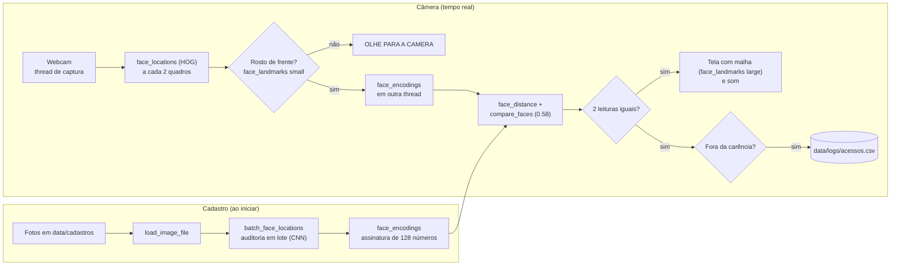

# VISIONGUARD | Sistema de Controle de Acesso Biométrico

**Instituição:** Centro Universitário UniAnchieta  
**Disciplina:** Engenharia de Software (Entrega 3)  
**Professor:** Prof. Dr. Roger Antunes  

## Equipe de Desenvolvimento
* **Arthur** - RA: 2606317
* **Caua Olaia Ferrari** - RA: 2603820
* **Cesar Amarez Zotovicci** - RA: 2614117
* **Gabriel Rodrigues do Santos Angioleto** - RA: 2601619
* **Leonardo Gabriel de Lima Costa** - RA: 2527941

---

## Visão Geral do Projeto
O **VisionGuard** é um protótipo MVP (Produto Mínimo Viável) de controle de acesso físico baseado em biometria facial, desenvolvido em Python. O sistema monitora um fluxo de vídeo em tempo real, detecta rostos, mapeia traços anatômicos e valida a identidade contra uma base de dados local autorizada.

O projeto destaca-se pela sua **arquitetura assíncrona multithread**, que separa a captura de vídeo da inferência matemática pesada, garantindo um monitoramento fluido a 30 FPS sem latência.

---

## Para quem é

O **VisionGuard** foi desenvolvido para auxiliar recepcionistas e profissionais de segurança patrimonial no controle de acesso em ambientes como academias e condomínios.

Nesses estabelecimentos, os horários de maior movimento podem gerar filas e atrasos na identificação de pessoas autorizadas. Além disso, o uso de crachás físicos apresenta riscos de perda, empréstimo ou utilização por terceiros.

Para solucionar essas dificuldades, o VisionGuard utiliza uma webcam para comparar o rosto das pessoas com fotografias previamente cadastradas. O sistema informa se a identificação foi autorizada ou negada e registra automaticamente as ocorrências em um arquivo CSV, com data e horário.

Entre seus principais diferenciais estão o baixo custo de implementação, a utilização de equipamentos comuns e o funcionamento local, sem necessidade de conexão com a internet.

**Limitações:** nesta versão, o VisionGuard não abre portas ou catracas fisicamente e não possui mecanismos de prova de vida, podendo ser enganado por fotografias. Portanto, é indicado como ferramenta de apoio à identificação e ao registro de acessos, não como substituto completo de sistemas de segurança física.

## Arquitetura e Fluxo de Dados
O projeto utiliza um padrão modular limpo (`src/utilitarios.py` e `src/reconhecedor.py` invocados por um `main.py` central):

* **Thread de Captura:** O OpenCV lê o hardware da câmera continuamente em background para esvaziar o buffer do Windows (`ThreadedCamera`).
* **Auditoria Prévia:** Ao inicializar, o sistema localiza em lote, com o detector CNN, o rosto de cada foto de cadastro (`batch_face_locations`). A assinatura biométrica é gerada a partir do rosto encontrado; se o CNN não achar rosto numa foto, o sistema tenta o detector HOG antes de descartá-la.
* **Pipeline de Detecção:** Detecção via HOG a cada 2 quadros. Quando há várias pessoas, só o rosto mais próximo da câmera (o maior) é verificado; os demais aparecem em cinza com o aviso "AGUARDE SUA VEZ". Antes do reconhecimento, o sistema confere se o rosto está de frente (olhos nivelados e nariz centralizado) e desenha a malha biométrica de 68 pontos no HUD.
* **Histerese e Logs:** Estabilizador temporal (*debounce*) calibrado a uma tolerância euclidiana de `0.58`. O sistema exige 2 leituras congruentes para alterar o estado de acesso, evitando falsos negativos por oscilação de luz, e registra os acessos no arquivo `data/logs/acessos.csv` seguindo as regras da seção "Regras do Registro".

### Como os dados andam



### Regras do Registro

O `data/logs/acessos.csv` tem uma linha por evento, com Data, Hora, Nome e Status (`AUTORIZADO` ou `NEGADO`).

| Situação | O que acontece |
| :--- | :--- |
| Pessoa parada diante da câmera | Um único registro, na chegada |
| A mesma pessoa volta em menos de 5 minutos | O som toca, mas não há linha nova no log (carência) |
| A mesma pessoa volta depois de 5 minutos | Novo registro |
| Duas pessoas se alternando na frente da câmera | Cada uma é registrada no máximo uma vez a cada 5 minutos |
| Pessoa desconhecida | Registrada como `DESCONHECIDO` / `NEGADO`, com carência de 30 segundos, porque todos os estranhos compartilham o mesmo nome |
| Ninguém na câmera por 2 segundos | O sistema considera que a pessoa saiu; a próxima aparição conta como nova chegada |

O sistema não distingue entrada de saída: cada chegada diante da câmera conta como um evento. Os tempos de carência ficam em `src/reconhecedor.py` (`CARENCIA_AUTORIZADO` e `CARENCIA_DESCONHECIDO`).

---

## Uso da Biblioteca `face_recognition` (Critério dos 8 Recursos)
O VisionGuard usa a biblioteca em dois módulos (`src/utilitarios.py` e `src/reconhecedor.py`), com os 8 recursos abaixo.

> **Como contamos:** a API pública da `face_recognition` tem 7 funções, e o sistema usa **todas elas**. A função `face_landmarks` aparece duas vezes na tabela porque usamos os **dois modelos treinados** que ela oferece: o de 5 pontos (`small`) e o de 68 pontos (`large`). São modelos diferentes, com finalidades diferentes no sistema (recursos 5 e 6).

| Nº | Recurso | Módulo | Uso no Sistema |
| :---: | :--- | :--- | :--- |
| **1** | `load_image_file` | `src/utilitarios.py` | Lê as fotos de cadastro como matrizes NumPy RGB. |
| **2** | `face_encodings` | `src/utilitarios.py` e `src/reconhecedor.py` | Gera a assinatura de 128 dimensões: no cadastro, com `num_jitters=5` (5 reamostragens para mais robustez) e a partir do rosto achado pela auditoria; na câmera, para o rosto que está sendo verificado. |
| **3** | `batch_face_locations` | `src/utilitarios.py` | Localiza em lote, com o detector CNN, o rosto de cada foto de cadastro. Avisa sobre fotos sem rosto ou com mais de um rosto. |
| **4** | `face_locations(model="hog")` | `src/reconhecedor.py` | Detecta os rostos da câmera em tempo real. |
| **5** | `face_landmarks(model="small")` | `src/reconhecedor.py` | Modelo de 5 pontos: confere se os olhos estão nivelados e o nariz centralizado, e recusa rostos inclinados ou de perfil antes do reconhecimento. |
| **6** | `face_landmarks(model="large")` | `src/reconhecedor.py` | Modelo de 68 pontos: desenha a malha biométrica no HUD. |
| **7** | `face_distance` | `src/reconhecedor.py` | Calcula a distância entre o rosto da câmera e cada rosto cadastrado; a menor distância indica o candidato e gera o percentual exibido. |
| **8** | `compare_faces(tolerance=0.58)` | `src/reconhecedor.py` | Decide se o candidato está dentro da tolerância de 0.58 para ser autorizado. |

---

## Guia de Instalação e Execução

### Pré-requisitos
* Windows 10 ou 11 (o sistema usa o DirectShow para a webcam e o `winsound` para os alertas sonoros).
* Python 3.12.
* Webcam.

Não é preciso instalar compilador C++ nem CMake: o projeto usa o `dlib-bin`, que já vem compilado.

### Passo a Passo

1. **Clonar o repositório:**
   ```powershell
   git clone https://github.com/leocosta-dev26/sistema-seguranca-facial
   cd sistema-seguranca-facial
   ```

2. **Criar e ativar o ambiente virtual com o Python 3.12:**
   ```powershell
   py -3.12 -m venv venv
   .\venv\Scripts\Activate.ps1
   ```
   Se o PowerShell bloquear a ativação, rode antes `Set-ExecutionPolicy -Scope CurrentUser RemoteSigned`.

3. **Instalar as dependências:**
   ```powershell
   pip install --no-deps -r requirements.txt
   ```
   O `--no-deps` é obrigatório. Sem ele, o pip tenta compilar o `dlib` original, o que falha sem o Visual C++ instalado.

4. **Preparar a base e executar:**
   * Coloque uma foto nítida e de frente (ex.: `Leonardo.jpg`) na pasta `data/cadastros/`. São aceitos `.jpg`, `.jpeg` e `.png`.
   * Inicie a aplicação:
     ```powershell
     python main.py
     ```
   * Para encerrar, pressione `q` ou feche a janela.
   * Para medir a tolerância de reconhecimento, inicie com `python main.py --calibrar`: a distância de cada leitura aparece no terminal (0 = rosto idêntico; quanto maior, mais diferente; abaixo de `0.58`, o acesso é liberado).

## Riscos e Plano B

| Risco | Plano B |
| :--- | :--- |
| O sistema só roda no Windows (`cv2.CAP_DSHOW` e `winsound`) | Apresentar no notebook do Leonardo, já instalado e testado |
| A webcam ou a demonstração ao vivo falhar | Vídeo da demonstração gravado com antecedência, com cópia offline |
| A instalação falhar numa máquina nova | Ambiente instalado e testado antes da apresentação; instalação com `pip install --no-deps -r requirements.txt` |
| Pouca luz na sala | Posicionar a câmera de frente para a luz; resultado do teste de iluminação registrado nos casos de teste |

## Casos de Teste e Resolução de Falhas Críticas

Durante a fase de testes práticos da Entrega 3, documentamos os seguintes cenários:

1. **Teste de Sucesso (Condições Normais):** Identificação estabilizada entre 76% e 85% de confiança, com emissão de alerta sonoro agudo e registro de status "AUTORIZADO" no CSV. Transição imediata para "DESCONHECIDO" com alerta grave ao captar uma face não cadastrada.
2. **Registro de Falha e Contingência (Latência de Vídeo):**
* **O Problema:** Na primeira iteração, a execução síncrona da inferência pesada (`face_encodings`) a cada quadro bloqueava a CPU, acumulando quadros na fila do driver e gerando um atraso de 1,5 a 2 segundos na imagem da câmera.
* **A Solução Aplicada:** Refatoramos a arquitetura para **Multithreading Assíncrono**. A câmera passou a ser consumida em tempo real por uma thread paralela dedicada (`ThreadedCamera`), enquanto a inferência pesada roda em segundo plano disparada apenas com enquadramento frontal validado. O atraso foi totalmente eliminado, sustentando 30 FPS contínuos.


3. **Limitações do Modelo:** O algoritmo HOG padrão atenua a detecção em rotações de perfil superiores a 45 graus ou a distâncias maiores que 2 metros (devido à redução de escala em 0.25x adotada para otimização do processador).

---

## Declaração de Uso de Ferramentas de IA

O uso de Inteligência Artificial generativa neste projeto ocorreu de forma pontual e focada. Utilizamos a ferramenta no início do desenvolvimento para auxiliar na ideação da estrutura modular inicial do projeto, consultamos esporadicamente no meio do processo para ultrapassar pequenos entraves sintáticos de integração com bibliotecas compiladas em C++, e, na fase final, utilizamos apenas para revisão textual e validação de documentação. Todo o planejamento arquitetural, calibração de histerese, isolamento de threads e resolução de gargalos de hardware foram executados e homologados integralmente pelos alunos.

---
## Vídeo de demonstração do VisionGuard  
So copiar o link a seguir e colocar em uma aba vazia: https://drive.google.com/file/d/1uVah6KAVSw06vzCmwhbU8Kg6wbz26qNw/view?usp=drive_link

---
## Como cadastrar uma pessoa

Para autorizar uma pessoa no sistema, basta colocar uma foto do rosto dela na pasta `data/cadastros/`.

**Formatos aceitos:** `.jpg`, `.jpeg` e `.png`.

**Nome exibido:** o nome vem do nome do arquivo. O sistema tira a extensão, troca `_` por espaço e coloca as iniciais em maiúsculas. Exemplo: `maria_silva.jpg` vira **Maria Silva**.

**Dicas para a foto:**
* rosto de frente, olhando para a câmera;
* boa iluminação, sem sombra forte no rosto;
* só uma pessoa na foto.

**Mensagens na inicialização:**
* `[AUDITORIA]`: o sistema confere, em lote, se cada foto da pasta tem um rosto.
* `[CADASTRO]`: mostra o nome da pessoa que está sendo cadastrada. Quando termina bem, aparece `[SUCESSO]`.
* `[AVISO]`: algo na foto merece atenção. Por exemplo, a foto tem mais de um rosto (o sistema usa o maior) ou não tem rosto (a foto é ignorada).

**Atenção:** depois de adicionar uma foto nova, é preciso **reiniciar o sistema** (`python main.py`) para ela valer. As fotos só são lidas na inicialização, e cada foto leva cerca de 10 segundos.

**Privacidade (LGPD):** o rosto é um dado biométrico sensível. Só cadastre pessoas que concordaram.

